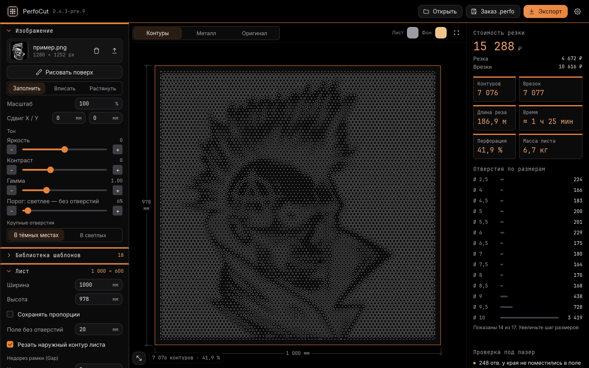
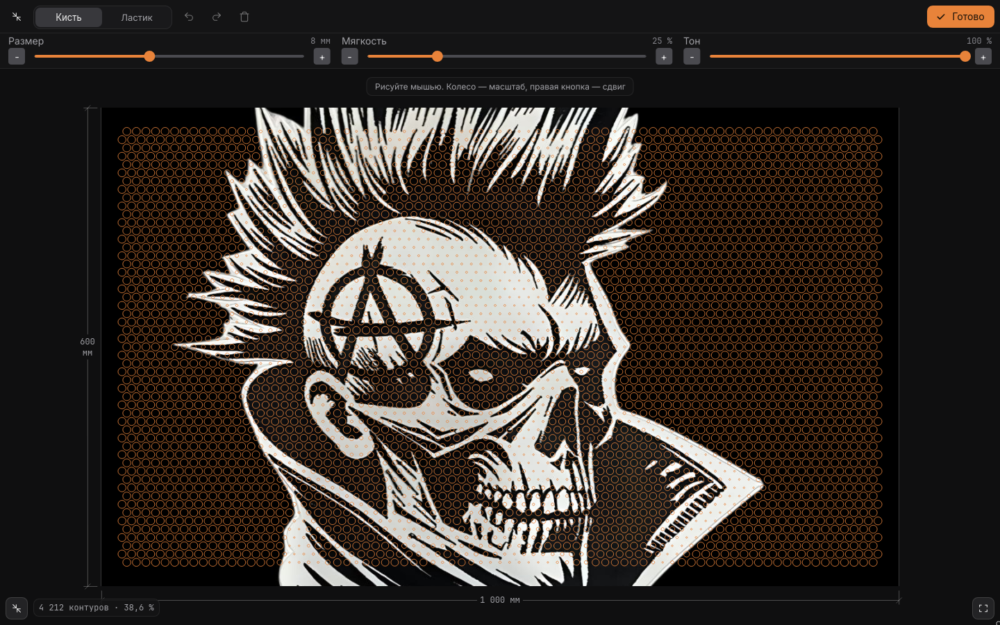
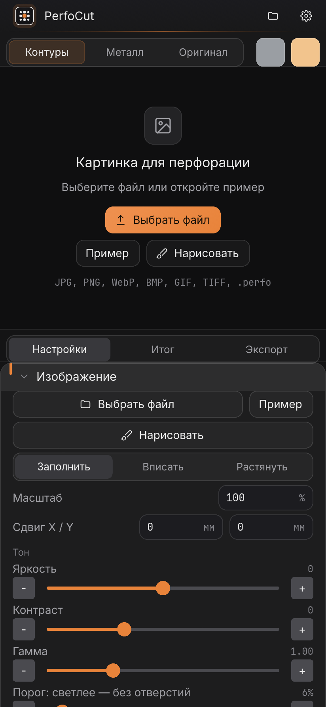
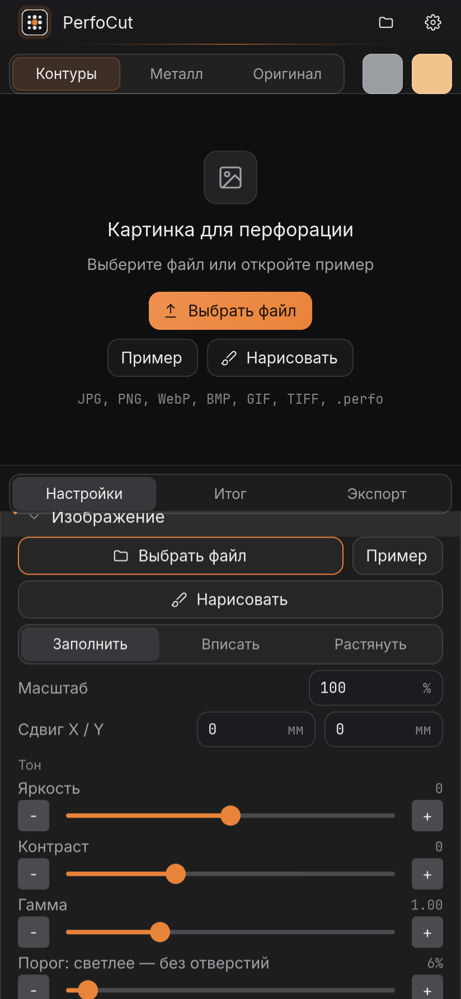

<div align="center">

# PerfoCut

**Картинка → перфорация → готовый файл для лазерного станка**

[](https://github.com/frikks/perfocut/releases/latest)
[](#скачать)
[](#скачать)
[](#скачать)

**Экспорт:** DXF · G-code · SVG · PDF · EPS · PLT · STL · STEP · CSV

[Возможности](#возможности) · [Как это работает](#как-это-работает) · [Скриншоты](#скриншоты) · [Мануал](#мануал) · [Скачать](#скачать)


</div>

---

## Возможности

### От картинки к узору

PerfoCut превращает фото, логотип или рисунок в перфорацию для лазерной резки листового металла. Размер и расположение отверстий зависят от тона: тёмные участки дают больше отверстий или крупнее диаметр.

- **Картинка:** JPG, PNG, WebP, BMP, GIF, TIFF; перетаскивание файла в окно; заполнить / вписать / растянуть; масштаб, сдвиг, яркость, контраст, гамма, порог.
- **Рисование от руки:** кисть и ластик с размером, мягкостью и тоном; штрихи хранятся вектором — толщину можно менять после рисования; отмена/повтор.
- **10 сеток:** квадратная, треугольная ×2, прямоугольная, косоугольная, шестиугольная, ромбическая, радиальная, мозаичная, адаптивная.
- **8 форм отверстий:** круг, квадрат, ромб, овал, звезда, треугольник, шестиугольник, прорезь.
- **Размер от тона:** диапазон, пропорционально или по плотности; фиксированные размеры, квантование, разброс и зерно.
- **Справочник материалов** (сталь, нержа, алюминий, оцинковка, медь) с плотностью и ценой за кг; пакетная обработка папки картинок; паспорт заказа в HTML для печати в PDF; история недавних `.perfo`.
- **18 готовых шаблонов** в отдельной вкладке: решётка динамика, вентиляция, сотовый щит, радиальная розетка и другие — один клик, и узор готов.



### Подготовка к резке

Программа проверяет узор до того, как вы понесете лист к станку.

- минимальный диаметр отверстия от толщины металла, минимальная перемычка, поле по краю листа;
- проверка реальной перемычки между всеми отверстиями с координатами проблемных мест;
- процент перфорации, масса листа, число контуров и врезок, длина и время реза;
- стоимость по метру реза, за врезку, за кг металла и за подготовку; любая валюта;
- **M-joint** — перемычки на отверстиях, чтобы вырезанные кружки не падали;
- **Gap** — недорезы рамки: лист держится на перемычках, маркеры видны на холсте;
- монтажные отверстия и гравировка артикула отдельным слоем `ENGRAVE`.


### Экспорт и файлы

- **DXF** — лазерные станки, AutoCAD, CorelDRAW; слой на каждый размер, настоящие дуги ARC.
- **G-code** — `.nc`/`.cnc`, профили CypCut, NCStudio, GRBL, LinuxCNC; свои команды лазера, заголовок и завершение.
- **SVG, PDF, EPS, PLT** — вектор для резки, печати и импорта; слои `CONTOUR/HOLES/MOUNT/ENGRAVE` включаются независимо.
- **3D STL и STEP** — лист с перфорацией для печати и CAD.
- **PNG** — картинка результата, **CSV** — отверстия для таблиц, **ZIP** — всё одним архивом.
- **`.perfo`** — файл заказа: картинка, штрихи и все настройки; открывается с тем же результатом.

### Интерфейс

- шесть техно-тем: HUD, Blueprint, Терминал, Осциллограф, Промышленная, AMOLED;
- шесть акцентов — цитрус, изумруд, лазурь, аметист, роза, магма — работают в любой теме;
- русский и английский языки;
- компактные настройки на Android, полный экран холста, зум колесом или двумя пальцами;
- сплеш со сканирующей матрицей, анимация при применении результата;
- авто-пропорции высоты листа, целевой процент перфорации с автоподбором шага;
- проверка обновлений вручную и тихо раз в сутки.

---

## Как это работает

1. **Откройте картинку** или нарисуйте узор на чистом холсте.
2. **Выберите шаблон** или настройте сетку, форму и размер от тона.
3. **Задайте металл и лазер:** толщину, перемычку, kerf, скорости, цены.
4. **Посмотрите итог:** проверки, длина реза, время, стоимость — всё пересчитывается автоматически.
5. **Экспортируйте** нужные форматы или сохраните заказ `.perfo`.

---

## Скриншоты

| Рисование кистью | Перфорация по рисунку |
| :---: | :---: |
|  |  |
| **Контуры для резки** | **Линии, светлая тема** |
|  |  |
| **Холст на весь экран** | **Настройки** |
|  |  |

| Телефон: настройки | Телефон: итог | Телефон: рисование |
| :---: | :---: | :---: |
|  |  |  |

Скриншоты снимаются автоматически из HTML-версии при каждом релизе.

---

## Мануал

Подробное руководство по всем разделам программы. Откройте нужный шаг по содержанию:

- [1. Первый запуск и интерфейс](#1-первый-запуск-и-интерфейс)
- [2. Картинка и холст](#2-картинка-и-холст)
- [3. Рисование от руки](#3-рисование-от-руки)
- [4. Узор и сетки](#4-узор-и-сетки)
- [5. Металл и лазер](#5-металл-и-лазер)
- [6. Проверка и итог](#6-проверка-и-итог)
- [7. Экспорт](#7-экспорт)
- [8. Заказ .perfo и пресеты](#8-заказ-perfo-и-пресеты)
- [9. Шаблоны](#9-шаблоны)
- [10. Настройки программы](#10-настройки-программы)
- [11. Частые вопросы](#11-частые-вопросы)

### 1. Первый запуск и интерфейс

При запуске появляется короткий сплеш со сканирующей матрицей; тап или клик закрывает его раньше. Основное окно делится на три зоны:

- **слева** — настройки (вкладки «Настройки» и «Шаблоны»);
- **центр** — холст с листом, размерными линиями и переключателем вида «Контуры / Металл / Оригинал»;
- **справа** — итог расчёта, проверки и экспорт.

На телефоне холст занимает верхнюю часть экрана, а снизу — вкладки «Настройки», «Шаблоны», «Итог» и «Экспорт». Кнопки вверху: открыть файл, сохранить заказ, экспорт и шестерёнка настроек.

**Перемещение по холсту:** колесо мыши — масштаб, перетаскивание — сдвиг, двойной клик или кнопка «Вписать» — показать весь лист. На телефоне: два пальца — масштаб и сдвиг.

### 2. Картинка и холст

Нажмите «Выбрать файл» или перетащите изображение в окно. Поддерживаются JPG, PNG, WebP, BMP, GIF, TIFF. Доступные файлы заказа `.perfo` тоже открываются здесь.

**Размещение на листе:**

- **Заполнить** — картинка покрывает весь лист, края обрезаются;
- **Вписать** — целиком внутри листа с полями;
- **Растянуть** — по ширине и высоте без сохранения пропорций.

«Масштаб» и «Сдвиг X/Y» тонко подстраивают изображение. При добавлении картинки высота листа автоматически приводится к её пропорциям — это можно выключить, сняв «Сохранять пропорции».

**Тон изображения:**

- «Порог: светлее — без отверстий» отсекает светлые участки;
- «Яркость», «Контраст», «Гамма» меняют распределение тонов;
- «Крупные отверстия в тёмных / светлых» переворачивает логику;
- «Залить / Вписать / Растянуть» и «Очистить холст» задают исходное состояние.

### 3. Рисование от руки

Кнопка «Нарисовать» открывает холст. Кисть ставит.tt штрихи, ластик возвращает подложку. Параметры кисти:

- **размер** — диаметр в мм холста;
- **мягкость** — плавность края;
- **тон** — насколько тёмным будет штрих; чем темнее, тем крупнее отверстия.

Штрихи хранятся вектором: после рисования можно менять общую толщину всех линий. `Ctrl+Z` / `Ctrl+Shift+Z` отменяют и повторяют. На телефоне для рисования используется палец, для масштаба — два пальца; «Готово» возвращает к настройкам и запускает расчёт.

### 4. Узор и сетки

Раздел «Узор» — основной инструмент настройки перфорации.

**Тип узора:**

- **Отверстия** — основная сетка точек;
- **Кольца** — концентрические кольца от центра листа;
- **Стиппл** — случайные точки без рядов, плотность по тону;
- **Линии** — прямые или синусоида, ширина от тона.

**Сетка** выбирается из десяти вариантов. Прямоугольная имеет отдельное поле «Пропорция Y / X», адаптивная следит за минимальной дистанцией между центрами, радиальная расставляет точки кольцами.

**Размер отверстий:**

- «Мин. размер» и «Макс. размер» — диапазон от тона;
- «Размер от тона» с кнопкой `SVG_t` — пропорциональный режим;
- «По плотности» — постоянный размер, сжимается только шаг;
- «Только заданные размеры» — фиксированный список через запятую;
- «Шаг размеров», «Разброс», «Зерно» — дополнительная вариативность.

**M-joint** добавляет перемычки на контуре каждого отверстия: «Количество», «Шаг» и «Ширина». Шаг и количество связаны — правка одного пересчитывает другое.

**Целевая перфорация:** задайте нужный процент открытой площади и нажмите «Подобрать шаг и размер» — программа переберёт варианты и выберет ближайший.

### 5. Металл и лазер

Здесь задаётся материал и режим резки. Пресеты материалов («Сталь 1 мм», «Сталь 2 мм», «Нерж. 1,5 мм») применяют все параметры сразу; свои пресеты можно сохранить и удалить.

- **Толщина металла** — влияет на минимальный диаметр отверстия;
- **Мин. отверстие, × толщины** — коэффициент для проверки;
- **Компенсация реза (kerf)** — на сколько уменьшить диаметры в файле;
- **Плотность** — г/см³ для расчёта массы;
- **Режим резки:** скорость, холостой ход, время врезки.

### 6. Проверка и итог

Правая панель показывает:

- общую стоимость и валюту;
- длину реза, время, число врезок, массу листа, процент перфорации;
- распределение отверстий по размерам;
- предупреждения: тонкая перемычка с координатами, слишком мелкие отверстия, отверстия у края.

Если предупреждений нет, стоит зелёная отметка «Загрузите картинку» или «Все проверки пройдены». Исправьте параметры, если видите предупреждение, — и пересчёт выполнится автоматически.

### 7. Экспорт

В разделе «Экспорт» сначала выбираются форматы, затем — нужные слои.

**Слои экспорта:**

- `CONTOUR` — наружный контур листа с недорезами;
- `HOLES` — отверстия узора;
- `MOUNT` — монтажные отверстия;
- `ENGRAVE` — надпись для гравировки.

Отключите ненужные слои, чтобы выгрузить, например, только контур для резки или только отверстия.

**Форматы:** DXF, G-code (`.nc`, `.cnc`), SVG, PDF, EPS, PLT, PNG, CSV, 3D STL, 3D STEP. Кнопка «Скачать выбранные, ZIP» собирает всё в один архив; «Сохранить заказ .perfo» сохраняет редактируемый проект.

**Профили станков** в разделе G-code: CypCut, NCStudio, GRBL, LinuxCNC. Профиль заполняет команды лазера, заголовок, завершение и число знаков; при необходимости поля можно править вручную.

### 8. Заказ .perfo и пресеты

Файл `.perfo` содержит картинку, векторные штрихи и все настройки. Он открывается через «Открыть» и воспроизводит результат один в один — удобно передавать заказ между компьютером и телефоном.

Пресеты материалов хранятся в 프로그램е: толщина, перемычка, kerf, скорости, врезки и цены. Выберите готовый или сохраните свой по имени — он появится в списке.

### 9. Шаблоны

Отдельная вкладка «Шаблоны» содержит 18 готовых узоров. Выберите карточку — применяются только настройки узора: сетка, форма, размеры и шаг. Размер листа, картинка, металл и цены не меняются. Применённый шаблон подсвечивается и запоминается.

### 10. Настройки программы

Шестерёнка в правом верхнем углу открывает окно настроек:

- **Тема:** HUD, Blueprint, Терминал, Осциллограф, Промышленная, AMOLED;
- **Акцент:** цитрус, изумруд, лазурь, аметист, роза, магма;
- **Язык:** русский или английский;
- **Вибрация** на телефоне;
- **Обновления:** кнопка «Обнова», статус и тихая проверка раз в сутки.

### 11. Частые вопросы

**Почему отверстия не появляются?** Проверьте порог: светлые участки отсекаются. Также убедитесь, что шаг не слишком велик для размера листа.

**Почему программа предупреждает о перемычке?** Два отверстия оказались ближе, чем минимальная перемычка. Увеличьте шаг или уменьшите максимальный размер.

**Как сделать отверстия разного размера?** Используйте «Размер от тона»: диапазон «мин–макс», пропорционально или по плотности.

**Как выгрузить только контур?** Отключите слои `HOLES`, `MOUNT` и `ENGRAVE` в разделе «Экспорт».

**Работает ли без интернета?** Да, вся обработка локальная. Интернет нужен только для проверки обновлений.

---

## Скачать

| Платформа | Файл | Как запустить |
| :--- | :--- | :--- |
| **Windows 10/11 x64** | [PerfoCut.exe](https://github.com/frikks/perfocut/releases/latest/download/PerfoCut.exe) | Скачать и запустить, установка не нужна. |
| **Android 7+ (arm64)** | [PerfoCut.apk](https://github.com/frikks/perfocut/releases/latest/download/PerfoCut.apk) | Открыть APK, разрешить установку из неизвестных источников. |
| **Браузер** | [PerfoCut.html](https://github.com/frikks/perfocut/releases/latest/download/PerfoCut.html) | Открыть в Chrome, Edge, Firefox или Safari, работает офлайн. |

Контрольные суммы SHA-256: **[SHA256SUMS.txt](https://github.com/frikks/perfocut/releases/latest/download/SHA256SUMS.txt)**. Все версии: [Releases](https://github.com/frikks/perfocut/releases).

---

<details>
<summary>Для разработчиков: сборка из исходников</summary>

Нужны Rust; для скриншотов — Node.js, для браузерной версии — цель `wasm32-unknown-unknown` и `wasm-bindgen`.

```bash
cargo test --workspace
cargo run -p perfocut
python web/build.py
cargo build --release -p perfocut --bin perfocut
```

Android собирается без Gradle (Rust-библиотека Slint + Java-обёртка, Android NDK, JDK 17, SDK 34) в GitHub Actions: `.github/workflows/release.yml`.

```text
core/      ядро: картинка, узор, проверка, расчёт, экспорт
app/       интерфейс Slint, состояние, платформенные функции
android/   Java-обёртка и сборка APK
web/       сборка HTML-версии и скриншоты
docs/      заметки к релизу, дизайн-система и скриншоты
```

</details>

---

## Ссылки

- [Дизайн-система](docs/design-system.md)
- [Все релизы](https://github.com/frikks/perfocut/releases)
- [Сообщить об ошибке](https://github.com/frikks/perfocut/issues)
- [Исходный код](https://github.com/frikks/perfocut)
- Автор: [@Frikks](https://t.me/Frikks)
