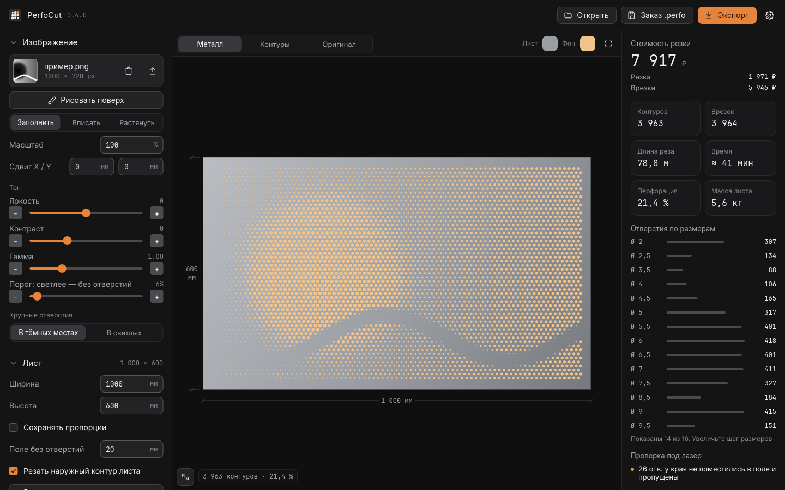
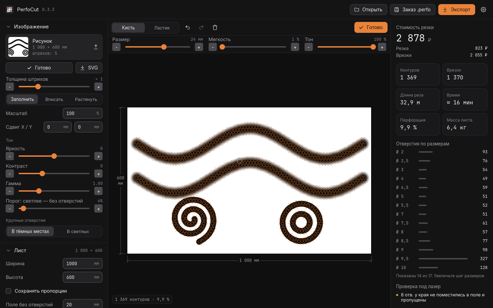
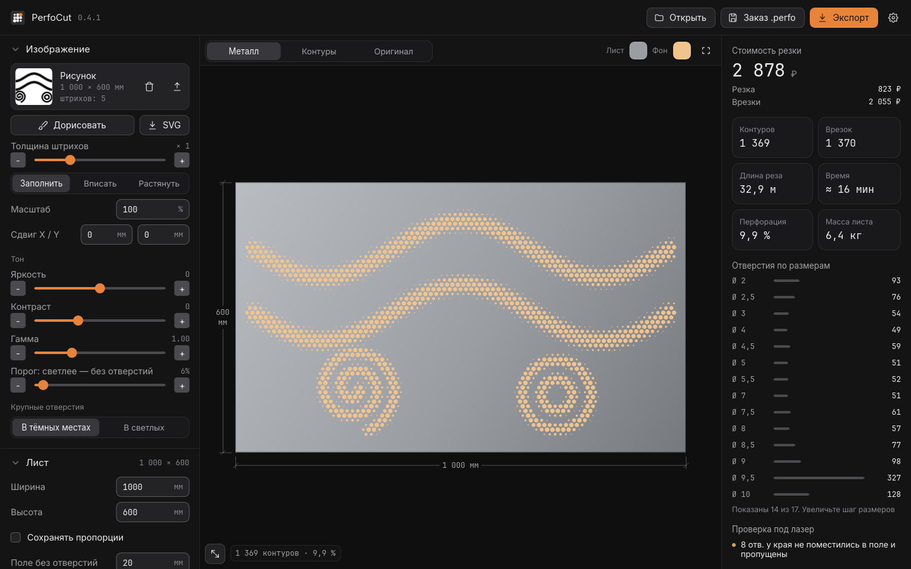
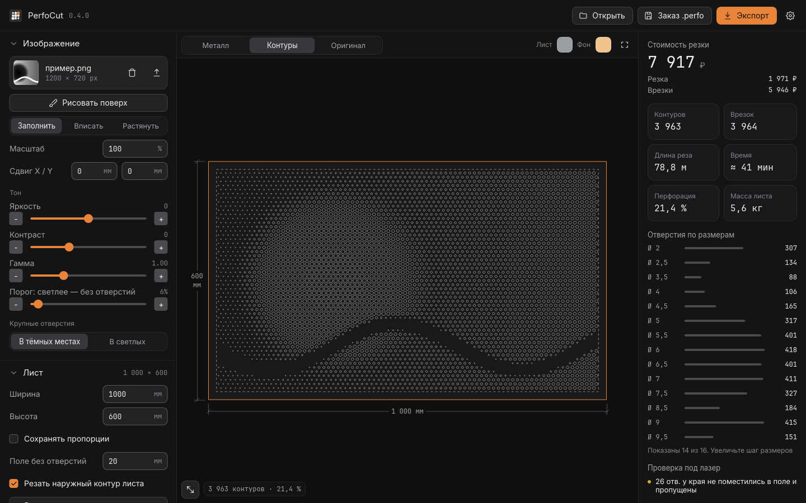
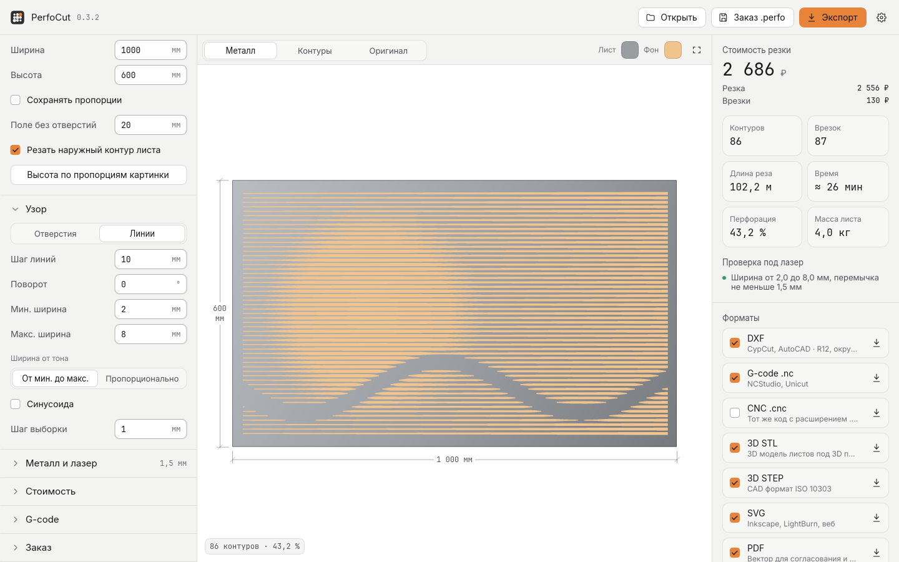
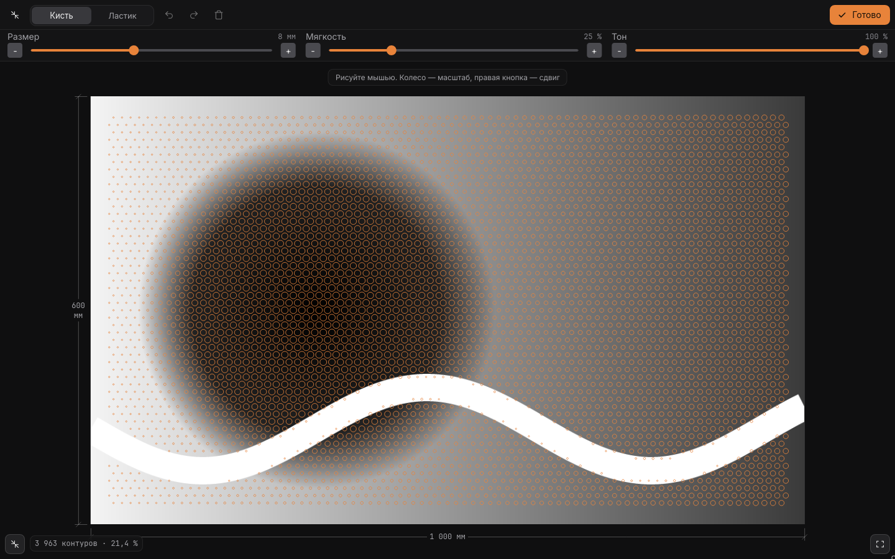
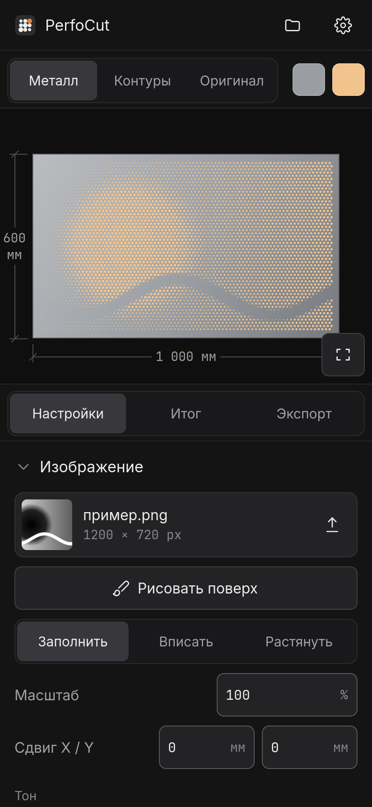
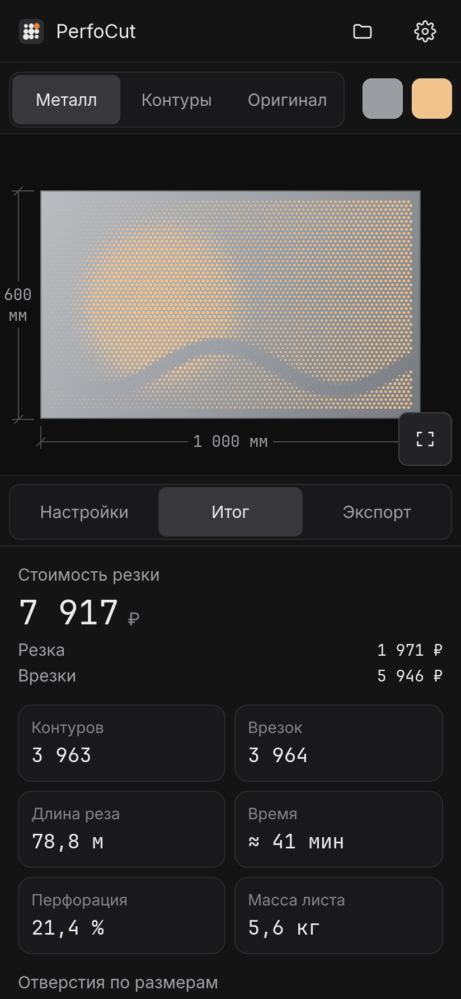
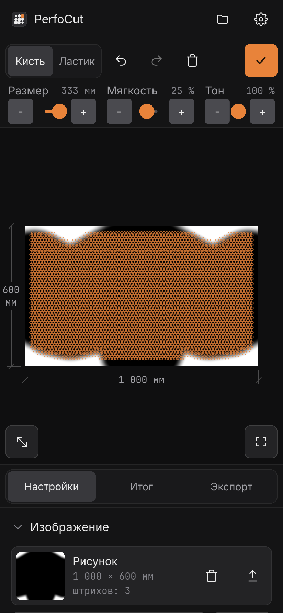
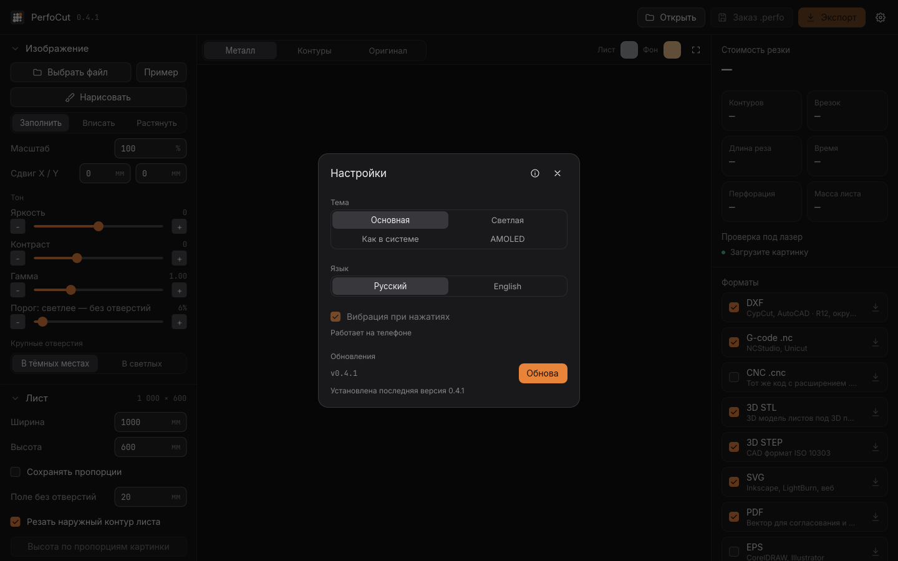

<div align="center">

# PerfoCut

**Картинка → перфорация → готовый файл для лазерного станка**

[](https://github.com/frikks/perfocut/releases/latest)
[](#скачать)
[](#скачать)
[](#скачать)
[](https://www.rust-lang.org)
[](https://slint.dev)

[Скачать](#скачать) · [Возможности](#возможности) · [Скриншоты](#скриншоты) · [Форматы](#форматы-экспорта) · [Хеши](#контрольные-суммы) · [Сборка](#сборка-из-исходников)

</div>

---

## Что такое PerfoCut

PerfoCut превращает фотографию, логотип или рисунок в перфорацию для лазерной резки листового металла. Программа подбирает размер и расположение отверстий по тону картинки, проверяет узор под конкретный металл и лазер, считает длину реза, время, массу листа и стоимость заказа — и выгружает файлы, которые понимает станок.

Одна и та же программа работает **на Windows, на Android и в браузере**. Написана целиком на Rust, интерфейс — на Slint. Без WebView, Electron, Tauri и окна Edge.

> **Текущая версия — 0.4.1.** Что изменилось: [заметки к релизу](https://github.com/frikks/perfocut/releases/latest).

---

## Скачать

| Платформа | Файл | Как запустить |
| :--- | :--- | :--- |
| **Windows 10/11 x64** | [PerfoCut.exe](https://github.com/frikks/perfocut/releases/latest/download/PerfoCut.exe) | Скачать и запустить. Установка не нужна. |
| **Android 7+ (arm64)** | [PerfoCut.apk](https://github.com/frikks/perfocut/releases/latest/download/PerfoCut.apk) | Открыть APK и разрешить установку из неизвестных источников. |
| **Браузер** | [PerfoCut.html](https://github.com/frikks/perfocut/releases/latest/download/PerfoCut.html) | Открыть в свежем Chrome, Edge, Firefox или Safari. Работает офлайн. |

Все версии и исходники: **[Releases](https://github.com/frikks/perfocut/releases)**.

---

## Контрольные суммы

SHA-256 для файлов версии **0.4.1**. Сверяйте после скачивания — это защищает от повреждённого или подменённого файла.

| Файл | SHA-256 |
| :--- | :--- |
| `PerfoCut.exe` | `e91addb707b9731609b1bf520ce1350aa288f22fc64180d5f235c047d22c35d9` |
| `PerfoCut.apk` | `4aa1517f5a327ce2f94b57e120643c00f09c5fe5828207608237a802b04c298b` |
| `PerfoCut.html` | `a3641f309d10acda9e4f0fb9c1cf198a14b910aa7db1dfc989151a27b0d8f792` |

Все суммы одним файлом: **[SHA256SUMS.txt](https://github.com/frikks/perfocut/releases/latest/download/SHA256SUMS.txt)**.

<details>
<summary>Как проверить хеш</summary>

**Windows (PowerShell):**

```powershell
Get-FileHash .\PerfoCut.exe -Algorithm SHA256
```

**Linux и macOS:**

```bash
sha256sum PerfoCut.exe
```

**Android:** удобнее всего сравнить сумму в файловом менеджере с поддержкой SHA-256 или проверить файл на компьютере.

</details>

---

## Возможности

### Картинка

- JPG, PNG, WebP, BMP, GIF, TIFF — обычные фото, сканы, логотипы и трафареты.
- Три способа размещения на листе: **заполнить**, **вписать**, **растянуть**.
- Масштаб, сдвиг по X и Y, яркость, контраст, гамма, порог.
- Режимы «крупные отверстия» — в тёмных или в светлых местах.
- Перетаскивание файла прямо в окно на компьютере.
- Чистый холст по размеру листа в одно нажатие.

### Рисование

- Кисть и ластик, размер, мягкость и тон.
- Рисование поверх картинки или на пустом листе.
- Отмена и повтор, в том числе `Ctrl+Z` / `Ctrl+Shift+Z`.
- Штрихи хранятся как **вектор**: толщину можно менять после рисования.
- Рисунок сохраняется в заказе `.perfo` и выгружается отдельным SVG.

### Перфорация

- **Отверстия:** квадратная, треугольная и шахматная сетка; круг, квадрат, ромб.
- **Линии:** прямые и синусоидой, с переменной шириной.
- Размер отверстия или линии зависит от тона картинки.
- Ограничения: минимальный и максимальный размер, шаг, поворот, сдвиг.
- Режим «как в SVG tracing» — плавное изменение размера от темноты.
- Фиксированный набор размеров и шаг квантования.

### Проверка под лазер

- Минимальный диаметр отверстия от толщины металла.
- Минимальная перемычка между отверстиями.
- Свободное поле по краю листа.
- Предупреждения о слишком плотном или хрупком узоре.
- Процент перфорации и масса листа.

### Расчёт заказа

- Количество контуров и врезок.
- Длина реза и время обработки.
- Стоимость по метру реза, за врезку, за м² металла и за подготовку.
- Любая валюта, скидки и наценки задаются ценой.
- Отверстия по размерам — сразу видно, каких больше.

### Экспорт

- **DXF** — лазерные станки, AutoCAD, CorelDRAW.
- **G-code** — `.nc` и `.cnc`, настройка команд лазера, начала и конца программы.
- **SVG, PDF, EPS, PLT** — вектор для печати, резки и импорта.
- **PNG** — картинка результата.
- **CSV** — отверстия и параметры для таблиц.
- **3D STL и STEP** — лист с перфорацией, выдавливание на толщину металла.
- **ZIP** — все выбранные форматы одним архивом.
- **`.perfo`** — файл заказа: картинка, штрихи и все настройки. Открывается с тем же результатом.

### Интерфейс

- Русский и английский языки.
- Темы: графит, светлая, как в системе, AMOLED.
- Полный экран для рисования: на телефоне — горизонтально, на компьютере — всё окно.
- Зум колесом и перемещение, на телефоне — двумя пальцами.
- Проверка обновлений в настройках и тихая проверка раз в сутки.

---

## Почему PerfoCut

| | |
| :--- | :--- |
| **Нативная скорость** | Ядро и интерфейс на Rust. Расчёт идёт в отдельном потоке — окно не подвисает даже на больших листах. |
| **Одна программа — три платформы** | Windows, Android и браузер собираются из одного кода. Результат и настройки одинаковые. |
| **Без WebView** | Не Electron, не Tauri, не окно Edge. Обычное окно Windows и нативное приложение Android. |
| **Работает офлайн** | Интернет нужен только для проверки обновлений. Вся обработка — на устройстве. |
| **Ничего не устанавливает** | EXE запускается сразу, HTML открывается двойным щелчком. |
| **Файлы для реального станка** | DXF, G-code, SVG, PDF, EPS, PLT, STL, STEP — не только картинка. |
| **Помогает не испортить металл** | Проверка минимальных отверстий и перемычек до резки. |
| **Считает деньги** | Стоимость резки, металла и подготовки заказа до отправки в работу. |
| **Исходники открыты** | Код на GitHub: можно собрать самому, проверить или предложить улучшение. |

---

## Скриншоты

<div align="center">



</div>

| Рисование кистью | Перфорация по рисунку |
| :---: | :---: |
|  |  |
| **Контуры для резки** | **Линии, светлая тема** |
|  |  |

<div align="center">

**Холст на весь экран** — на телефоне горизонтально, на компьютере во всё окно



</div>

| Телефон: настройки | Телефон: итог | Телефон: рисование |
| :---: | :---: | :---: |
|  |  |  |

Скриншоты снимаются автоматически с готовой HTML-версии при каждом релизе.

---

## Как это работает

1. **Откройте картинку** или нарисуйте узор на чистом холсте.
2. **Настройте перфорацию:** сетку, форму, шаг, размеры, ограничения.
3. **Укажите металл и лазер:** толщину, минимальное отверстие, перемычку, скорость.
4. **Проверьте результат** под лазер и посмотрите стоимость.
5. **Экспортируйте** нужный формат или сохраните заказ `.perfo`.

---

## Форматы экспорта

| Формат | Для чего |
| :--- | :--- |
| `DXF` | Лазерные станки, AutoCAD, CorelDRAW, CAM. Слой на каждый размер отверстия. |
| `G-code (.nc, .cnc)` | Готовый код для станка: команды лазера, врезки, холостой ход, дуги. |
| `SVG` | Вектор для браузера, Illustrator, Inkscape, LightBurn. |
| `PDF` | Печать и согласование с клиентом. |
| `EPS` | CorelDRAW, Illustrator, полиграфия. |
| `PLT` | HPGL для старых плоттеров и станков. |
| `PNG` | Картинка результата для превью и документов. |
| `CSV` | Отверстия и параметры для Excel и расчётов. |
| `3D STL` | 3D-модель листа с отверстиями для печати и визуализации. |
| `3D STEP` | Настоящее B-rep-тело для FreeCAD, SolidWorks и других CAD. |
| `ZIP` | Все выбранные форматы одним архивом. |
| `.perfo` | Файл заказа: картинка, штрихи и все настройки. |

---

## Обновления

В версии **0.4.1**:

- кнопка **«Обнова»** переехала в компактное окно настроек — туда, где тема и язык;
- при запуске программа **раз в сутки** тихо проверяет GitHub и показывает оранжевую точку на шестерёнке, если вышла новая версия;
- обновление **скачивается прямо из программы**: `.exe` в «Загрузки» на Windows, `.apk` через `DownloadManager` на Android;
- в браузере открывается страница релиза — WebAssembly-версия не может писать в папку загрузок сама;
- проверяются только **стабильные релизы**: предварительные версии и черновики не предлагаются.

<div align="center">

**Компактные настройки: тема, язык, вибрация и кнопка «Обнова»**



</div>

---

## Сборка из исходников

Нужны Rust и Node.js для скриншотов. Для браузерной версии — цель `wasm32-unknown-unknown` и `wasm-bindgen`.

```bash
# тесты
cargo test --workspace

# запуск на компьютере
cargo run -p perfocut

# браузерная версия: dist/PerfoCut.html
python web/build.py

# релизная сборка Windows
cargo build --release -p perfocut --bin perfocut
```

Android собирается без Gradle: Rust-библиотека Slint плюс небольшая Java-обёртка. Нужны Android NDK, JDK 17 и Android SDK 34. В репозитории это делает GitHub Actions (`.github/workflows/release.yml`), локальная сборка APK не требуется.

### Структура проекта

```text
core/      ядро: картинка, узор, проверка, расчёт, экспорт
app/       интерфейс Slint, состояние, платформенные функции
android/   Java-обёртка NativeActivity и сборка APK
web/       сборка HTML-версии и скриншоты
docs/      заметки к релизу и скриншоты
```

---

## Ссылки

- [Все релизы](https://github.com/frikks/perfocut/releases)
- [Сообщить об ошибке](https://github.com/frikks/perfocut/issues)
- [Исходный код](https://github.com/frikks/perfocut)
- Автор: [@Frikks](https://t.me/Frikks)

<div align="center">

Сделано на Rust и Slint. Без WebView, Electron и Tauri.

</div>
