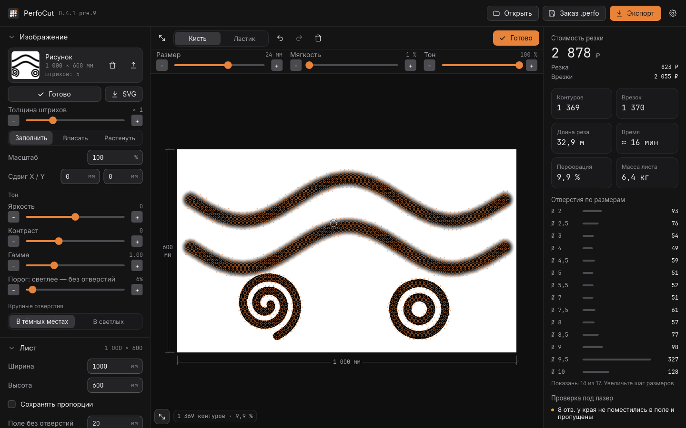
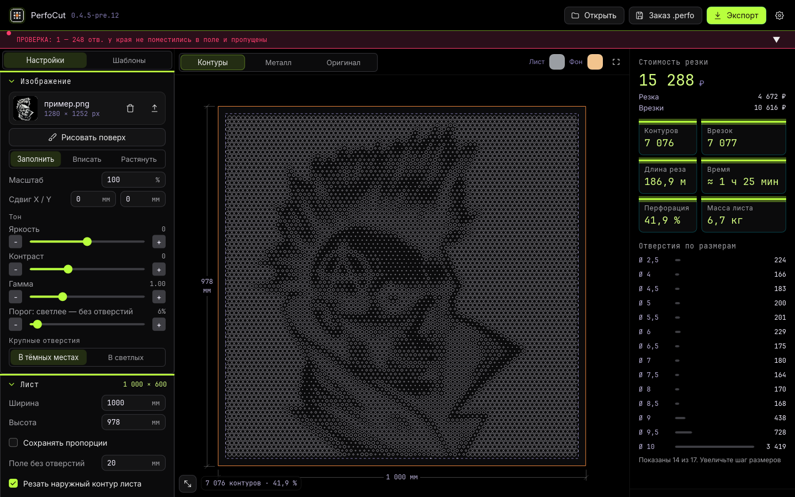
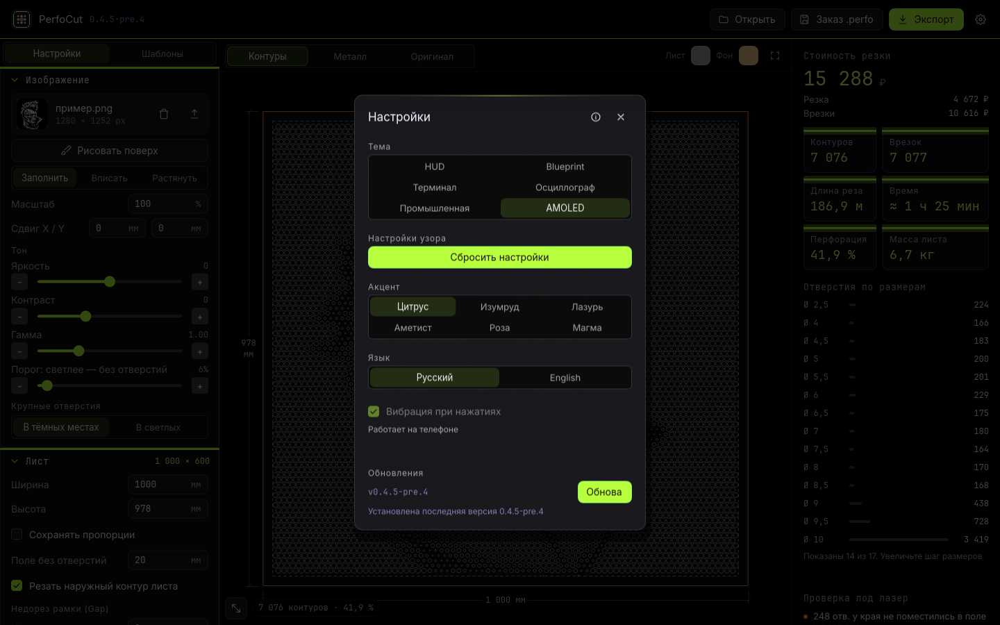
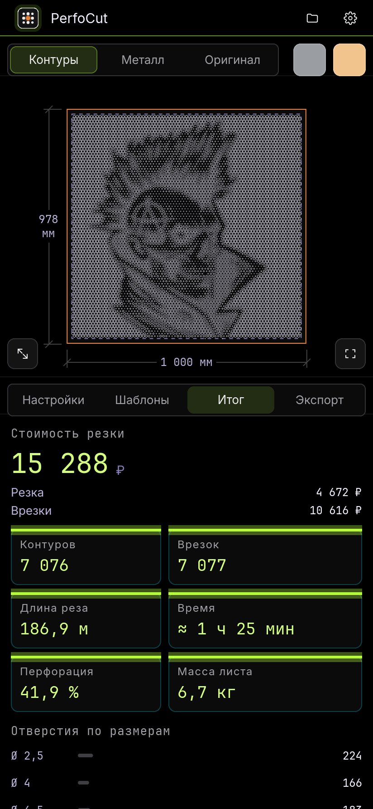

<div align="center">

# PerfoCut

**Картинка → перфорация → готовый файл для лазерного станка**

[](https://github.com/frikks/perfocut/releases/latest)
[](#скачать)
[](#скачать)
[](#скачать)
[](https://www.rust-lang.org)
[](https://slint.dev)

[Скачать](#скачать) · [Возможности](#возможности) · [Скриншоты](#скриншоты) · [Форматы](#форматы-экспорта) · [Сборка](#сборка-из-исходников)


</div>

---

## Что такое PerfoCut

PerfoCut превращает фото, логотип или рисунок в перфорацию для лазерной резки листового металла. Размер и расположение отверстий зависят от тона картинки; программа проверяет узор под толщину металла и лазер, считает длину реза, время, массу листа и стоимость заказа, а затем выгружает файлы для станка.

Одна программа на Windows, Android и в браузере. Написана на Rust, интерфейс — на Slint: без WebView, Electron, Tauri и окна Edge. Работает офлайн, интернет нужен только для проверки обновлений.

Стабильная версия — **0.4.3**. [Заметки к релизу](https://github.com/frikks/perfocut/releases/latest).

---

## Скачать

| Платформа | Файл | Как запустить |
| :--- | :--- | :--- |
| **Windows 10/11 x64** | [PerfoCut.exe](https://github.com/frikks/perfocut/releases/latest/download/PerfoCut.exe) | Скачать и запустить, установка не нужна. |
| **Android 7+ (arm64)** | [PerfoCut.apk](https://github.com/frikks/perfocut/releases/latest/download/PerfoCut.apk) | Открыть APK, разрешить установку из неизвестных источников. |
| **Браузер** | [PerfoCut.html](https://github.com/frikks/perfocut/releases/latest/download/PerfoCut.html) | Открыть в Chrome, Edge, Firefox или Safari, работает офлайн. |

Контрольные суммы SHA-256: **[SHA256SUMS.txt](https://github.com/frikks/perfocut/releases/latest/download/SHA256SUMS.txt)**. Все версии: [Releases](https://github.com/frikks/perfocut/releases).

---

## Возможности

### Картинка и рисование

- JPG, PNG, WebP, BMP, GIF, TIFF; перетаскивание файла в окно на ПК.
- Размещение на листе: заполнить, вписать, растянуть; масштаб, сдвиг X/Y, яркость, контраст, гамма, порог.
- Кисть и ластик с настраиваемыми размером, мягкостью и тоном; рисование поверх картинки или на чистом листе.
- Штрихи хранятся вектором: толщину можно менять после рисования; отмена/повтор, `Ctrl+Z` / `Ctrl+Shift+Z`.
- Высота листа автоматически подгоняется под пропорции добавленной картинки.

### Узор и перфорация

- **4 узора:** отверстия, кольца, стиппл (случайные точки), линии (прямые и синусоида).
- **10 сеток** для отверстий: квадратная, треугольная, треугольная 2, прямоугольная (пропорция Y/X), косоугольная, шестиугольная, ромбическая, радиальная, мозаичная, адаптивная с минимальной дистанцией между центрами.
- **8 форм отверстий:** круг, квадрат, ромб, овал, звезда, треугольник, шестиугольник, прорезь.
- Размер от тона: диапазон «мин–макс», пропорционально (как SVG tracing, кнопка **SVG_t**) или по плотности (постоянный размер, шаг сжимается в тёмных местах).
- Фиксированный набор размеров, квантование, случайный разброс и зерно; поворот и сдвиг сетки.
- **Микроджоинты (M-joint):** перемычки на контуре каждого отверстия, чтобы вырезанный кружок не падал; количество, шаг и ширина, шаг связан с количеством.
- **Недорез рамки (Gap):** контур листа режется с разрывами, лист держится на перемычках; количество, шаг, ширина и сдвиг по контуру ползунком. Маркеры недорезов видны на холсте.

### Проверка и расчёт

- Минимальный диаметр от толщины металла, минимальная перемычка, поле по краю листа, предупреждения о хрупком узоре.
- Процент перфорации и масса листа.
- Контуры, врезки, длина реза, время обработки; стоимость по метру реза, за врезку, за кг металла (площадь × толщина × плотность) и за подготовку. Любая валюта.
- Пресеты материалов: толщина, перемычка, kerf, скорости, врезки и цены выбираются одним нажатием.
- Распределение отверстий по размерам.

### Интерфейс

- Русский и английский языки; четыре режима темы (графит, светлая, системная, AMOLED) и шесть акцентов (цитрус, изумруд, лазурь, аметист, роза, магма).
- Технологичный сплеш со сканирующей матрицей и анимацией применения результата.
- Компактные настройки на телефоне, полный экран холста, зум колесом или двумя пальцами.
- Файл заказа `.perfo` сохраняет картинку, штрихи и все настройки; проверка обновлений вручную и тихо раз в сутки.

---

## Скриншоты

| Рисование кистью | Перфорация по рисунку |
| :---: | :---: |
|  |  |
| **Контуры для резки** | **Линии, светлая тема** |
|  |  |

| Холст на весь экран | Настройки |
| :---: | :---: |
|  |  |

| Телефон: настройки | Телефон: итог | Телефон: рисование |
| :---: | :---: | :---: |
|  |  |  |

Скриншоты снимаются автоматически из HTML-версии при каждом релизе.

---

## Форматы экспорта

| Формат | Для чего |
| :--- | :--- |
| `DXF` | Лазерные станки, AutoCAD, CorelDRAW; слой на каждый размер. |
| `G-code (.nc, .cnc)` | Код станка: команды лазера, врезки, холостой ход, дуги. |
| `SVG`, `PDF`, `EPS`, `PLT` | Вектор для печати, резки и импорта в CAM-системы. |
| `PNG` | Картинка результата. |
| `CSV` | Отверстия и параметры для таблиц. |
| `3D STL`, `3D STEP` | Лист с перфорацией для 3D-печати и CAD. |
| `ZIP` | Все выбранные форматы одним архивом. |
| `.perfo` | Файл заказа: картинка, штрихи и все настройки. |

---

## Сборка из исходников

Нужны Rust; для скриншотов — Node.js, для браузерной версии — цель `wasm32-unknown-unknown` и `wasm-bindgen`.

```bash
cargo test --workspace
cargo run -p perfocut
python web/build.py
cargo build --release -p perfocut --bin perfocut
```

Android собирается без Gradle (Rust-библиотека Slint + Java-обёртка, Android NDK, JDK 17, SDK 34) в GitHub Actions: `.github/workflows/release.yml`.

```text
core/      ядро: картинка, узор, проверка, расчёт, экспорт
app/       интерфейс Slint, состояние, платформенные функции
android/   Java-обёртка и сборка APK
web/       сборка HTML-версии и скриншоты
docs/      заметки к релизу и скриншоты
```

---

## Ссылки

- [Все релизы](https://github.com/frikks/perfocut/releases)
- [Сообщить об ошибке](https://github.com/frikks/perfocut/issues)
- [Исходный код](https://github.com/frikks/perfocut)
- Автор: [@Frikks](https://t.me/Frikks)
