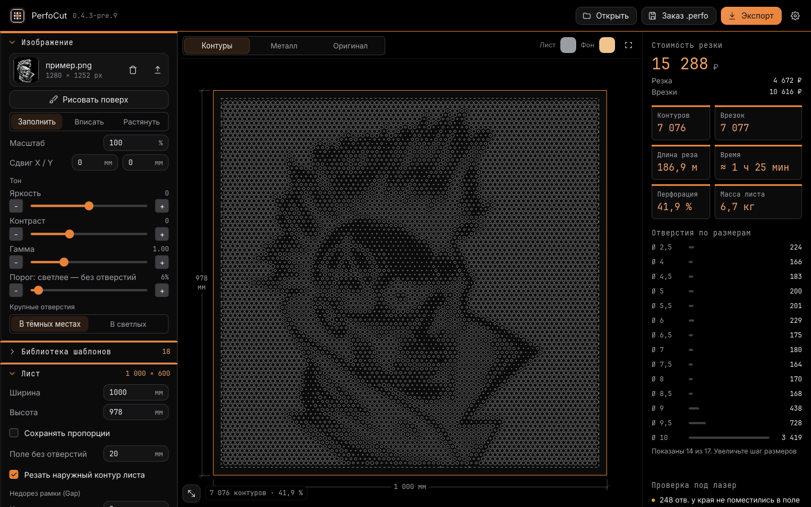
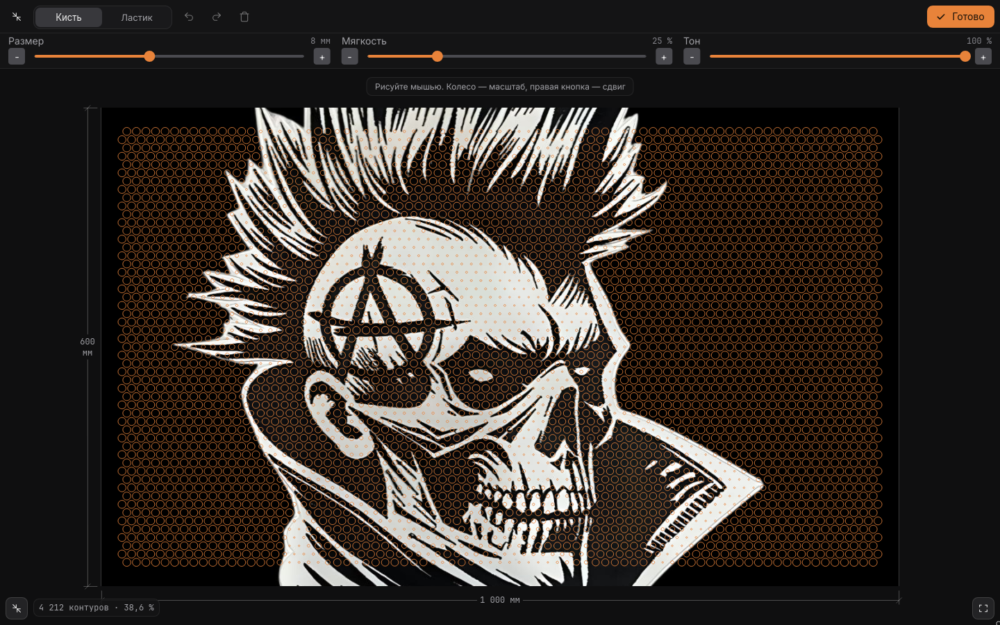
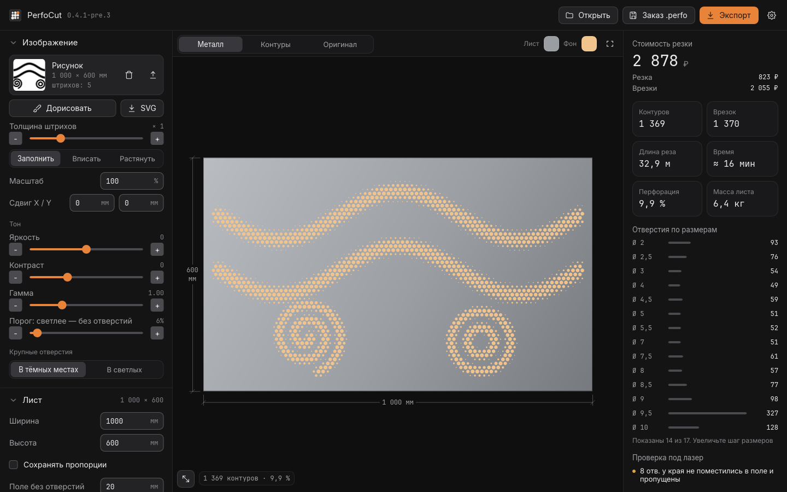
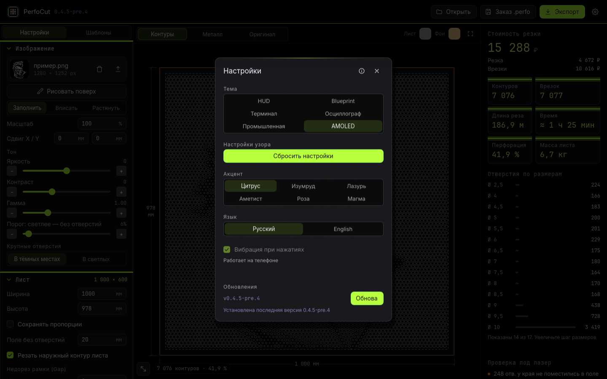

**Стабильный выпуск 0.4.1.** Обновление переехало в маленькое окно настроек, а рисование на телефоне стало удобнее.

### Что нового

- **Кнопка «Обнова» в настройках.** Шестерёнка справа вверху открывает компактное окно: тема, язык, вибрация и проверка обновлений теперь в одном месте. Внизу — текущая версия и кнопка «Обнова».
- **Тихая проверка раз в сутки.** При запуске программа сама спрашивает GitHub о последнем стабильном релизе, без окон и сообщений. Если версия новее, на шестерёнке появляется оранжевая точка, а результат сохраняется до следующего запуска.
- **Скачивание прямо из программы.** Кнопка «Скачать» кладёт файл в папку загрузок: на Windows — `PerfoCut-0.4.1.exe` через системный `curl`, на Android — `PerfoCut-0.4.1.apk` через `DownloadManager`. В браузере открывается страница релиза: WebAssembly-версия не может писать в «Загрузки» сама.
- **Только стабильные релизы.** Запрос идёт на `releases/latest`: предварительные выпуски и черновики не предлагаются.
- **Понятные состояния.** «Проверяю…», «Установлена последняя версия 0.4.1», «Доступна версия X», «Скачиваю…», «Скачано: путь». Ошибки проверки и скачивания показываются в том же окне и всплывающим сообщением.

### Рисование на телефоне

- **Холст во всю ширину.** Убрана мёртвая зона слева: лист и жестовая прокрутка работают по всей ширине экрана, а вырез и системные панели учитываются только отступами шапки и кнопок.
- **Компактная панель инструментов.** Вместо двух крупных строк — один ряд по 40 px: кисть, ластик, отмена, повтор, настройки кисти, полный экран и «Готово». Размер, мягкость и тон открываются карточкой поверх холста, там же «Очистить».
- **Жест двумя пальцами без точек.** Касание без движения больше не оставляет точку, а синтетические нажатия Slint после жеста не начинают штрих: масштаб и сдвиг работают чисто.
- **Альбомная ориентация.** Окно больше не растягивается до 520 px: на низком экране помещаются и пустой экран с кнопками, и карточка настроек кисти.

### Файлы

Вся программа на Rust, интерфейс на Slint. Без WebView и окна Edge.

- **PerfoCut.exe**: Windows 10/11 x64, без установки.
- **PerfoCut.apk**: Android 7+ (arm64). Разрешите установку из неизвестных источников.
- **PerfoCut.html**: та же программа в браузере (WebAssembly). Свежий Chrome, Edge, Firefox или Safari, работает без интернета.

Контрольные суммы SHA-256 — в файле `SHA256SUMS.txt` и в README.
