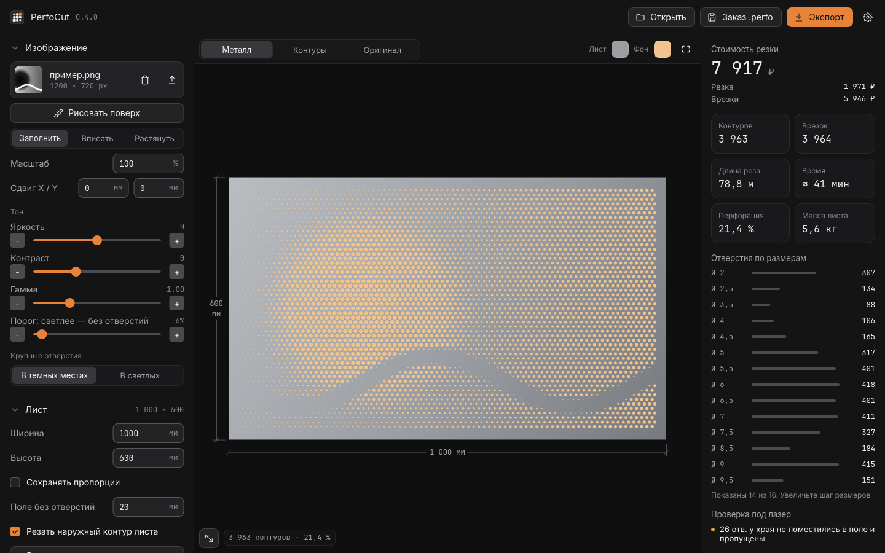
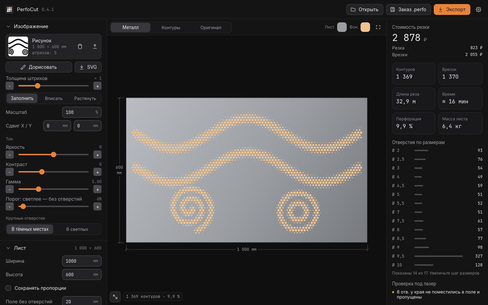

**Предварительная версия.** Главное в 0.3.2: точная подстройка ползунков кнопками и экспорт листа в 3D — STL и STEP.

### Что нового

- **Кнопки шага у ползунков.** У каждого ползунка слева и справа появились кнопки «−» и «+»: значение меняется ровно на один шаг, без перетаскивания. Работает и в настройках, и в инструментах кисти.
- **Экспорт в 3D STL.** Лист с перфорацией выдавливается на толщину материала: верх, низ, торцы и стенки всех отверстий. Файл открывается в слайсерах и 3D-редакторах.
- **Экспорт в 3D STEP.** Тот же лист выгружается как твёрдое тело в формате ISO 10303-21 (AP214, единицы — миллиметры). Подходит для FreeCAD, SolidWorks и других CAD.
- **Исправлено:** длинное сообщение проверки под лазер больше не наезжает на блок «Форматы».
- **Исправлено:** дробные числа в замечаниях проверки пишутся через запятую, как в остальном интерфейсе.

### Файлы

Вся программа на Rust, интерфейс на Slint. Без WebView и окна Edge.

- **PerfoCut.exe**: Windows 10/11 x64, без установки.
- **PerfoCut.apk**: Android 7+ (arm64). Разрешите установку из неизвестных источников.
- **PerfoCut.html**: та же программа в браузере (WebAssembly). Свежий Chrome, Edge, Firefox или Safari, работает без интернета.
